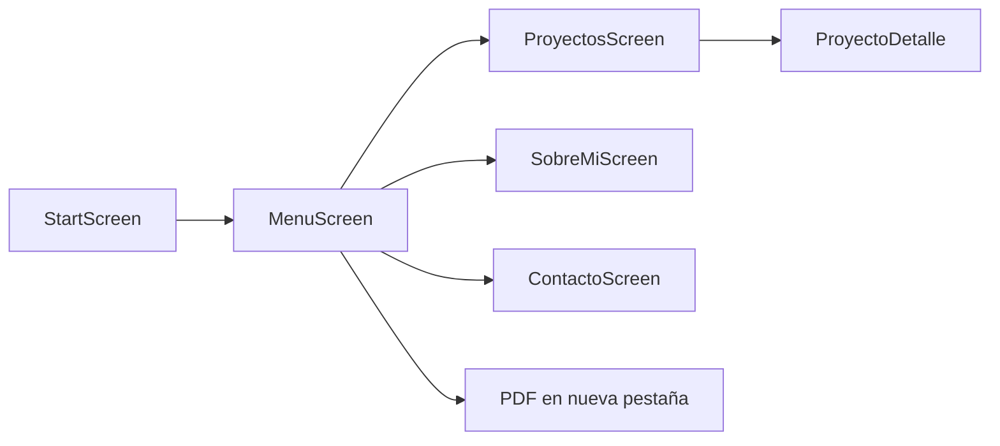

# Portfolio personal (React + Vite)

Sitio web interactivo con estética retro / pixel art: pantalla de inicio, menú navegable, secciones de proyectos, sobre mí y contacto. Incluye música de fondo, efectos de sonido y demos en video de proyectos seleccionados.

El código de la aplicación vive en esta carpeta (`portfolio/`). El repositorio Git puede estar un nivel arriba; los comandos de Git deben ejecutarse desde la **raíz del repo**, no desde una subcarpeta duplicada.

## Stack

| Área | Tecnología |
|------|------------|
| UI | React 19, JSX |
| Build | Vite 7 |
| Animaciones | Framer Motion |
| Contacto | EmailJS (`emailjs-com`) |
| Estilos | CSS global + estilos en línea por pantalla |
| Deploy | Netlify (`netlify.toml`) |

No hay router de URLs: la navegación es un **estado local** en `App.jsx` (`start` → `menu` → pantallas hijas).

## Requisitos

- Node.js 18+ (recomendado 20+)
- npm

## Instalación y scripts

Desde esta carpeta (`portfolio/`):

```bash
npm install
npm run dev      # desarrollo (por defecto http://localhost:5173)
npm run build    # salida en dist/
npm run preview  # sirve el build local
npm run lint     # ESLint
```

### Contacto (EmailJS)

El formulario en `ContactoScreen.jsx` envía con [EmailJS](https://www.emailjs.com/) (service, template y public key en ese archivo). No requiere variables de entorno en Netlify.

Los campos del template deben llamarse `nombre`, `email` y `mensaje`.

## Estructura del proyecto

```
portfolio/
├── public/                 # Assets estáticos (URL = /archivo.ext)
│   ├── *.mp3, *.png, …     # Fondos, iconos, música, SFX
│   ├── *.mp4               # Demos de proyectos (archivos pesados)
│   └── Curriculum Vitae (Emiliano Pereyra).pdf   # CV descargable
├── src/
│   ├── App.jsx             # Pantallas, BGM, ducking con videos, botón mute
│   ├── main.jsx            # Entry + StrictMode
│   ├── index.css           # Reset y estilos base
│   ├── hooks/
│   │   └── useIsMobile.js  # breakpoint 600px
│   └── pages/
│       ├── StartScreen.jsx       # PRESS START + SFX
│       ├── MenuScreen.jsx        # Menú principal + CV en nueva pestaña
│       ├── ProyectosScreen.jsx   # Grilla y datos de proyectos
│       ├── ProyectoDetalle.jsx   # Detalle, carrusel, video con controles
│       ├── SobreMiScreen.jsx
│       └── ContactoScreen.jsx    # Formulario EmailJS
├── vite.config.js          # base: './' (rutas relativas al build)
├── netlify.toml            # Build y redirect SPA en Netlify
└── docs/
    └── GUIA-CONTENIDO.md   # Cómo editar proyectos y medios
```

## Flujo de la aplicación



- **Start:** desbloquea audio con gesto del usuario; baja BGM brevemente durante el SFX de inicio.
- **Menú:** teclado (↑/↓ + Enter) o toque; opción **Ver Currículum** abre el PDF en `public/`.
- **Proyectos:** tarjetas en grilla; el orden mostrado es el inverso del array en código (los últimos agregados aparecen primero).
- **Detalle:** imágenes o un video con `controls`; enlaces a repositorio cuando `repo` no es `null`.

## Audio

- **BGM:** alterna `music1.mp3` y `music2.mp3` en bucle.
- **Mute:** botón fijo arriba a la derecha (no depende de la pantalla).
- **Ducking:** si un `<video>` se reproduce **con sonido** (no muted, volumen > 0), la música baja a ~0.04 hasta pausar o silenciar el video. Los previews en la grilla van en mute y no afectan el BGM.

> En Safari iOS el volumen del elemento `<audio>` puede no ser modificable por JavaScript; el ducking por `volume` puede no aplicarse en esos dispositivos.

## Despliegue (Netlify)

Configuración típica si el sitio apunta a esta carpeta como raíz del repo en GitHub:

| Campo | Valor |
|-------|--------|
| Build command | `npm run build` |
| Publish directory | `dist` |

Si el repositorio tiene la app dentro de `portfolio/`, en Netlify usá **Base directory** = `portfolio` (el publish sigue siendo `dist` relativo a esa base).

`netlify.toml` incluye el redirect SPA (`/*` → `index.html`). Los archivos estáticos del build (PDF, videos, imágenes) se sirven desde `dist/` antes del fallback.

Archivos grandes en `public/` (videos > 50 MB) generan advertencias en GitHub; conviene comprimir o usar hosting externo si el repo crece mucho.

No versionar `tmp-frames/` ni `.env.local` (ver `.gitignore`).

## Seguridad y datos

- No commitear `.env`, claves API ni material confidencial de clientes.
- Las demos y capturas deben evitar datos internos (usuarios de prueba, sesiones, PII).
- EmailJS expone solo la **public key** en el cliente; el resto de la cuenta se gestiona en el panel de EmailJS.

## Documentación adicional

- [Guía de contenido y proyectos](docs/GUIA-CONTENIDO.md)

## Licencia

Proyecto personal; el código y los assets son de uso del autor salvo terceros indicados en cada demo (logos, música, etc.).
